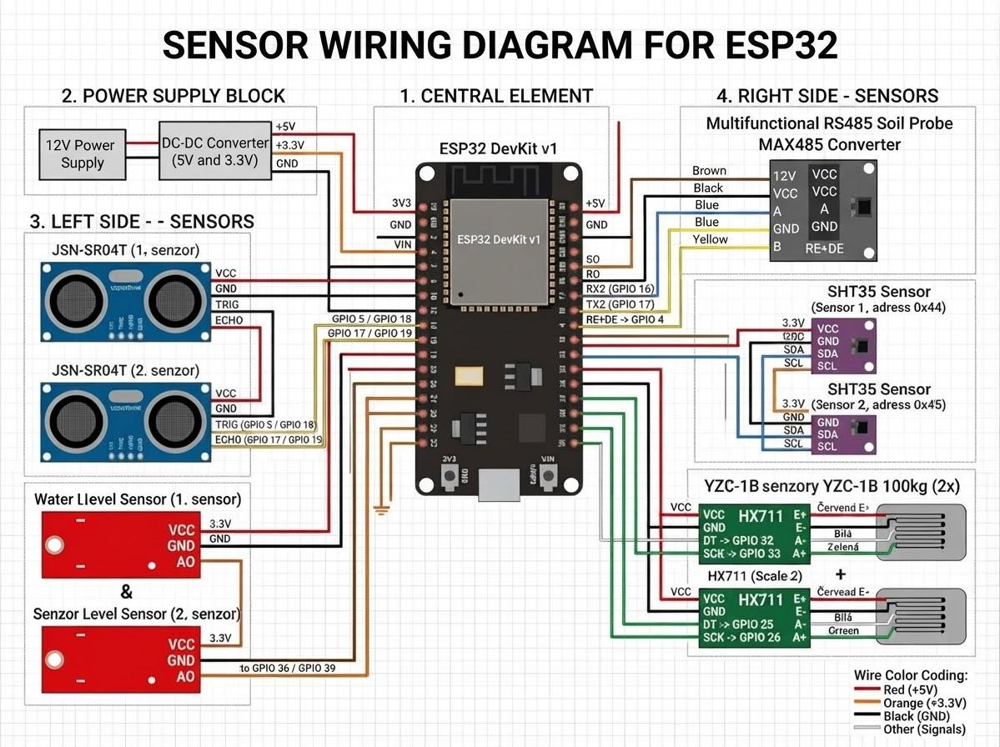

# ESP32 Multi-Sensor Grow Monitoring System

A practical ESP32-based environmental monitoring system for indoor growing. It reads multiple sensors and streams data as JSON over USB serial every second. Includes a Windows dashboard with alarms and CSV logging.

## Features

## Wiring Diagram



- 2× SHT35 temperature & humidity sensors (I2C)
- 2× JSN-SR04T ultrasonic sensors (distance / water level)
- 2× Analog water level sensors
- 2× 100 kg load cells with HX711 amplifiers (individual tare via serial commands)
- RS485 multifunctional soil probe (moisture, temperature, EC, pH) via MAX485
- Real-time JSON output over USB serial (115200 baud)
- Windows Tkinter dashboard with visual alarms and CSV logging

## Hardware Notes

- ESP32 DevKit v1
- **Important:** TRIG of the second ultrasonic sensor must be connected to **GPIO 13** (not GPIO 17) to avoid conflict with RS485 TX.

## Software

- Firmware: `esp32_sensor_firmware.ino` (Arduino / PlatformIO)
- Dashboard: `sensor_dashboard.py` (Python + pyserial)

Required Arduino libraries:
- Adafruit SHT31
- HX711
- ArduinoJson

## Load Cell Calibration

Calibration factors are set to `-21500.0` as a starting point. You will need to calibrate them with a known weight. See the included English guide for details.

Tare commands (send via serial):
- `TARE1` — tare first scale
- `TARE2` — tare second scale

## Installation (Dashboard)

```bash
pip install pyserial
python sensor_dashboard.py
```

## Support

This project is free.  
If it helps you, a small contribution is appreciated:

→ https://paypal.me/JosefTichy1/3USD

## License

Feel free to use, modify, and share.
